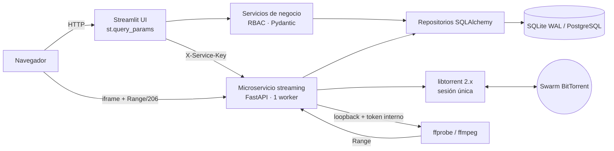
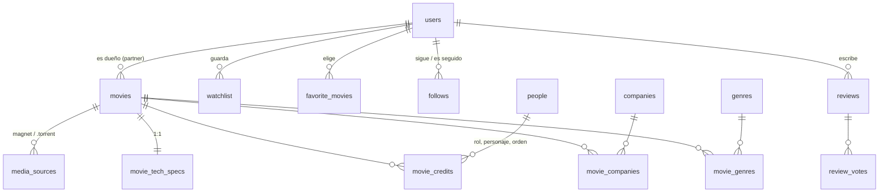

# Rascal Does Not Dream of Cinema — Arquitectura v2

> **Estado actual (v2.2).** La UI prevista en Streamlit se sustituyó en v2.1 por una interfaz web
> FastAPI + Jinja2 (`rascal/web.py` + `rascal/webui/`) montada en el mismo proceso que el
> microservicio de streaming. Las secciones 1–7 describen la evolución desde el monolito Flask y
> siguen siendo válidas para datos, RBAC y P2P; la sección 8 documenta lo añadido en v2.2.

Este documento describe la evolución del monolito Flask + MongoDB (`app.py`) hacia una arquitectura por capas con:

- una capa de datos relacional,
- servicios de negocio con RBAC,
- un microservicio de streaming P2P independiente,
- y una UI en Streamlit, que se entrega en una fase posterior.

## 1. Diagnóstico del código anterior

### 1.1 Dependencias

| Librería actual | Problema / cuello de botella | Reemplazo | Impacto |
|---|---|---|---|
| `pymongo` | Documentos planos con géneros como `"A\|B"` o lista, director como texto y reparto como lista de nombres. Búsquedas con `$regex` sin índice. Un `find_one` por reseña o por película en `movie_detail` y en los perfiles (N+1). Sin integridad referencial. | SQLAlchemy 2.0 sobre SQLite (WAL) en desarrollo y PostgreSQL en producción | Esquema N:M real, FKs con `ON DELETE`, transacciones ACID y agregados con `GROUP BY` sobre índices. |
| `pyspark` | JVM de 4 GB para unos miles de filas. En `streamlitapp.py` la `SparkSession` se crea a nivel de módulo, en cada *rerun*. | Agregación SQL + Polars | Sin Java y arranque inmediato. Los análisis tardan milisegundos. |
| `pandas` | Copias en memoria y mezcla con la lógica de las rutas. | Polars (`AnalysisResult.data`) | Columnar y sin conversión. Streamlit y Altair lo aceptan directamente. |
| `matplotlib` + `seaborn` | PNG en base64 en cada petición y estado global de `pyplot` (`rcParams.update` en cada análisis; no es *thread-safe*). | Altair (incluido con Streamlit) y Chart.js en el reproductor | Gráficas interactivas sin renderizado en el servidor. |
| `scikit-learn` | Unos 100 MB (con SciPy) para una regresión de **una** variable. | OLS cerrado con NumPy (`domain/analytics.py`) | Mismas métricas (coeficiente, intercepto, MSE, R², n) sin la dependencia pesada. |
| Flask + Jinja | WSGI síncrono: cada stream de video ocupa un worker. | FastAPI/uvicorn (streaming) + Streamlit (UI) | Cientos de streams concurrentes en un proceso y validación Pydantic nativa. |
| Flask-Mail | Acoplado a Flask, con la contraseña SMTP en el código. | `smtplib` de la biblioteca estándar + configuración por variables de entorno | Sin secretos en el repositorio. |
| `werkzeug.security` | Atado a Flask. | `argon2-cffi` (Argon2id) | Los hashes Werkzeug se verifican con `hashlib` y se re-hashean en el primer login. |
| `requests` | Llamadas sin `timeout` (TMDB). | `httpx` | Timeouts y cliente reutilizable (`StreamerClient`). |
| `random` (código 2FA) | Generador no criptográfico. | `secrets` | Códigos impredecibles. |
| `tqdm` | Importado pero sin usar. | — (eliminado) | — |
| `reportlab`, `faker` | Pertenecen a `proyecto_final/final.py`, un dashboard de eventos de red ajeno a la plataforma. | Fuera de alcance | — |

### 1.2 Errores y riesgos corregidos

| Hallazgo en el código anterior | Corrección |
|---|---|
| Contraseña de Gmail, URI de Atlas con credenciales y API key de TMDB en el código fuente. | Ahora todo se lee desde `RASCAL_*` y `.env` (fuera de git). `Settings` se niega a arrancar en `prod` con secretos por defecto. **Hay que rotar las credenciales expuestas.** |
| El código 2FA se guardaba en `session['2fa_code']`, una cookie firmada pero **no cifrada**, legible por el usuario. | El código se guarda como HMAC en `login_challenges`, con expiración y un máximo de intentos. |
| `@app.route('/review/<id>/vote')` estaba pegado al `return` anterior; Python lo evaluaba como `x @ app.route(...)` y la ruta nunca se registraba. | `ReviewService.vote()` + `review_votes` (PK compuesta, voto idempotente, sin auto-voto). |
| `follow_user` hacía un *upsert* con `followed: {$ne: …}`: tras seguir a alguien no se podía seguir a nadie más. Además redirigía a un endpoint inexistente. | `follows` con PK `(follower_id, followed_id)` y `CHECK` que impide seguirse a uno mismo. |
| La regresión filtraba años comparando cadenas (`"$gte": str(min_year)`). | `release_year SMALLINT` + `BETWEEN`. |
| Escalas mezcladas: MovieLens 0.5–5 frente a la app 1–10. Los promedios salían a la mitad. | Escala única de medias estrellas 1..10. La migración multiplica ×2 las reseñas de usuarios numéricos. |
| "Usuario no encontrado" frente a "Credenciales inválidas" permitía enumerar cuentas. | Mensaje genérico, verificación de tiempo constante y bloqueo tras N fallos. |
| Rutas duplicadas de edición y `url_for` con parámetros incorrectos. | Un único servicio, `CatalogService.update_movie`. |

## 2. Arquitectura



| Capa | Paquete | Responsabilidad | Prohibido |
|---|---|---|---|
| Datos | `rascal.data` | Modelos ORM, motor y sesiones, repositorios (todo el SQL) y transformaciones *legacy*. | Reglas de negocio y permisos. |
| Negocio | `rascal.domain` | DTOs y formularios Pydantic, calificación por estrellas, métricas, analítica, reglas de códecs y casos de uso con RBAC. | Construir SQL o importar Streamlit/FastAPI. |
| Auth | `rascal.auth` | Hash Argon2id, RBAC, OTP por correo y tokens HMAC. | — |
| P2P (ingesta) | `rascal.torrents` | bencode seguro, magnet v1/v2, inspección de `.torrent`. Python puro, sin libtorrent. | — |
| Streaming | `rascal.streaming` | Motor libtorrent, lectura *piece-aware*, Range/206, probe/remux y reproductor. | Lógica de catálogo. |
| UI | `rascal.ui` *(siguiente entrega)* | Vistas Streamlit; sólo consume servicios y `StreamerClient`. | SQL directo e importar libtorrent. |

### 2.1 Árbol de directorios

```
rascal-cinema/
├── docs/                 ARCHITECTURE.md · schema.sql (DDL PostgreSQL generado)
├── migrations/           Alembic (env.py, versions/0001_esquema_inicial_normalizado.py)
├── scripts/
│   ├── run_all.py           streamer + UI en paralelo (SIGTERM ordenado)
│   ├── migrate_from_mongo.py Mongo → SQL, transaccional, --dry-run
│   ├── seed_demo.py         catálogo de dominio público/CC-BY + reseñas + magnets
│   ├── create_user.py       crea el primer admin / partners
│   └── init_db.py           create_all (sólo desarrollo)
├── src/rascal/
│   ├── config.py            pydantic-settings (RASCAL_*)
│   ├── data/                models.py · db.py · enums.py · legacy.py · repositories/{catalog,reviews,users,media}.py
│   ├── domain/              schemas.py · ratings.py · metrics.py · analytics.py · playback.py · slugs.py
│   │   └── services/        catalog.py (Partner) · queries.py (lectura) · reviews.py · social.py
│   ├── auth/                passwords.py · rbac.py · tokens.py · mailer.py · service.py
│   ├── torrents/            bencode.py · magnet.py · ingest.py
│   ├── streaming/           engine.py · pieces.py · http_range.py · media.py · api.py · client.py · templates/player.html
│   └── ui/                  (siguiente entrega: app.py + vistas)
├── tests/                   112 pruebas, incluida la P2P real de extremo a extremo
├── requirements*.txt · pyproject.toml · alembic.ini · .env.example
```

## 3. Modelo de datos

El DDL completo para PostgreSQL está en `docs/schema.sql`, con índices, CHECKs y FKs. La migración Alembic `0001` crea el mismo esquema en SQLite o PostgreSQL, y `alembic check` confirma que no hay deriva respecto a los modelos.



Decisiones clave:

- **Personas.** Actores, directores y equipo usan una sola tabla puente, `movie_credits`, con `role` (cast, director, writer, producer, cinematographer, composer, editor), `character_name` y `billing_order`. Una persona puede ser directora y productora de la misma película. `UNIQUE(movie_id, person_id, role)` impide duplicados. El índice `(person_id, role)` hace instantánea la filmografía.
- **Calificación.** `reviews.rating` es `SMALLINT CHECK 1..10`, en medias estrellas, exactamente lo que enviaba el widget. Varias entradas por usuario y película se comportan como un diario. Los índices `(movie_id, rating)` y `(movie_id, created_at)` cubren histogramas y listados.
- **Fuentes P2P.** `media_sources` guarda `info_hash` (v1 de 40 hex o v2 de 64 hex), el `.torrent` en `torrent_data` (LargeBinary, normalmente menos de 1 MB) o el magnet normalizado. Guarda también el archivo de video elegido, los códecs sondeados, `playback_mode` y `rights_statement`. El `CHECK payload_matches_kind` garantiza coherencia y `UNIQUE(movie_id, info_hash)` evita duplicados.
- **Unicidad.** Usuario y email son únicos sin distinguir mayúsculas (índices sobre `lower()`).
- **Auditoría.** `audit_log` se escribe en la **misma transacción** que el cambio auditado.

## 4. Streaming P2P

### 4.1 Por qué un microservicio

Streamlit re-ejecuta el script completo en cada interacción y no puede responder Range requests. Si la sesión de libtorrent viviera ahí, cada *rerun* la destruiría o duplicaría. El servicio FastAPI es el **único dueño** de la sesión: se ejecuta con `--workers 1` y atiende muchos streams porque la espera de piezas es asíncrona. La UI sólo:

1. llama a `POST /api/sources/{id}/start` con `X-Service-Key`, y
2. embebe `GET /player/{id}?token=…` en un iframe.

El token es HMAC, con *scope* `play`, y caduca según `RASCAL_PLAYBACK_TOKEN_TTL_S`.

### 4.2 Estrategia de piezas

| Mecanismo | Configuración | Motivo |
|---|---|---|
| Descarga secuencial | `torrent_flags.sequential_download` (equivale a `set_sequential_download(True)`) | El resto del archivo llega en orden de reproducción. |
| Sólo el video | `prioritize_files`: 4 para el video elegido y 0 para subtítulos, *samples*, NFO… | No gasta ancho de banda en lo que no se reproduce. |
| Cabecera | `RASCAL_STREAM_HEAD_BYTES` (10 MiB), prioridad 7 + *deadline* | `ftyp`/`moov` (MP4 con *faststart*), EBML/Segment (MKV). |
| Cola | `RASCAL_STREAM_TAIL_BYTES` (6 MiB), prioridad 7 + *deadline* intercalado tras las 2 primeras piezas | `moov` al final (MP4 sin *faststart*), `Cues` de MKV, índice AVI. |
| Ventana de lectura | `set_piece_deadline` sobre `RASCAL_STREAM_READAHEAD_BYTES` desde la posición pedida | Un *seek* del reproductor reprioriza esa zona al instante. |
| Lectura segura | `have_piece()` antes de leer cada trozo del disco | El archivo es *sparse*: sin esto se servirían ceros. |
| Reanudación | `save_resume_data(save_info_dict)` periódico y al apagar, con escritura atómica | Reiniciar no vuelve a pedir metadata ni a verificar piezas. |

Las *deadlines* son el mecanismo fiable: libtorrent las atiende como piezas críticas en tiempo por delante del orden secuencial. La prioridad 7 es un refuerzo.

**Verificado en `tests/test_p2p_e2e.py`** con un seeder libtorrent real en loopback, limitado a unos 700 KB/s:

- la cola del MP4 (`moov` al final) se sirvió con **206** cuando la descarga iba por el **62 %**;
- el archivo completo servido por Range es idéntico byte a byte;
- `readme.txt` no se descargó;
- se escribió el resume data al apagar.

### 4.3 Compatibilidad de contenedores y códecs

| Contenedor | Códecs | Modo | Entrega |
|---|---|---|---|
| MP4/MOV | H.264 8-bit + AAC/MP3 | `direct` | `/stream` con Range; *seek* nativo. |
| WebM | VP8/VP9/AV1 + Opus/Vorbis | `direct` | `/stream`. |
| MKV/AVI/TS | H.264 8-bit + AAC | `remux` | `/remux`: `ffmpeg -c copy` → fMP4 (`frag_keyframe+empty_moov`); CPU ≈ 0. |
| MKV/AVI/TS | H.264 + AC3/E-AC3/DTS/FLAC | `remux_audio` | Video copiado y audio convertido a AAC 192k. |
| cualquiera | HEVC, MPEG-4 ASP, VC-1, H.264 10-bit | `transcode` / `unsupported` | libx264 `veryfast`, sólo con `RASCAL_ALLOW_FULL_TRANSCODE=true`; consume mucha CPU. |

ffprobe y ffmpeg leen **a través del endpoint interno con Range** (`/internal/raw`, token de *scope* `internal`). Así ffmpeg pide el índice al final del archivo y el servidor espera a que esas piezas lleguen por P2P. Un MKV se puede remultiplexar mientras se descarga; el E2E lo verifica con un MKV H.264/AC3 que sale como fMP4 H.264/AAC.

El modo se decide así:

1. Al añadir un `.torrent` se estima por la extensión del archivo.
2. Al abrir el reproductor por primera vez se lanza un *probe* en segundo plano.
3. Si el probe cambia la estrategia, la página se recarga sola.
4. Si el navegador falla en modo `direct`, el reproductor cambia a `remux` automáticamente.

**Limitación (manejo básico):** el fMP4 progresivo no admite *seek* nativo. El reproductor ofrece "Ir a mm:ss", que reinicia ffmpeg con `-ss` antes de `-i`, un *seek* por índice. Para *seek* nativo en MKV, el siguiente paso sería HLS: `ffmpeg -f hls` con segmentos en disco.

## 5. RBAC y panel Partner

| Permiso | User | Partner | Admin |
|---|:---:|:---:|:---:|
| Escribir reseñas y votar · ver streams | ✓ | ✓ | ✓ |
| Panel Partner · crear películas | | ✓ | ✓ |
| Editar película / gestionar fuentes | | sólo las suyas (`owner_id`) | todas |
| Borrar películas · reasignar dueño | | | ✓ |
| Analítica · gestión de usuarios y roles · auditoría | | | ✓ |

- Los permisos se comprueban en los **servicios**, no en la UI. Manipular `st.query_params` no da acceso.
- `MovieForm` valida todos los atributos: metadatos, relaciones, especificaciones técnicas, deduplicación de personas y géneros, IMDb id y relación de aspecto.
- `CatalogService.update_movie` reemplaza relaciones y créditos dentro de la unidad de trabajo. Ante cualquier error se revierte **todo**, también el título; hay una prueba que lo verifica.
- Cada fuente exige `rights_statement` (licencia o titularidad declarada por el partner) y queda auditada.

## 6. Contrato de enrutamiento para la UI (siguiente entrega)

Cada vista se codifica en `st.query_params`, de modo que todas las URLs se pueden compartir y marcar:

| Vista | Parámetros | Servicio |
|---|---|---|
| Inicio | `?view=home` | `CatalogQueries.home()` |
| Película | `?view=movie&slug=sintel-2010` | `movie_detail`, `movie_reviews`, `StreamerClient.player_url` |
| Persona | `?view=person&slug=cary-grant[&role=cast][&sort=rating][&year_from=1940][&genre=comedia][&min_stars=3.5]` | `entity_profile("person", …)` |
| Productora | `?view=company&slug=universal-pictures[&…filtros]` | `entity_profile("company", …)` |
| Género | `?view=genre&slug=terror[&…filtros]` | `entity_profile("genre", …)` |
| Usuario | `?view=user&u=ana` | `user_profile` |
| Búsqueda | `?view=search&q=keaton&type=directors` | `search` |
| Panel Partner | `?view=partner[&movie=12]` | `CatalogService` |
| Analítica (admin) | `?view=analytics&id=top_genres` · `?view=regression` | `run_analysis`, `year_rating_regression` |

Los filtros se mapean 1:1 a `FilmographyFilters`. Las métricas de entidad son: películas, total de reseñas, promedio (por reseña y por película), distribución de 10 barras, usuarios distintos, watchlist, actividad de 30 días y `popularity_score`:

```
popularity_score = distintos + 0.5·watchlist + 2·reseñas_30d
```

## 7. Guía de despliegue local

### Requisitos previos

- Python 3.11 o superior.
- ffmpeg y ffprobe en el `PATH`: `apt install ffmpeg`, `brew install ffmpeg` o `winget install Gyan.FFmpeg`.
- `libtorrent` se instala con pip; se probó con la rueda 2.1.1 en Linux x86_64. Si pip no encuentra una rueda para tu plataforma o versión de Python, usa `conda install -c conda-forge libtorrent`, ejecuta el streamer en WSL/Docker, o trabaja la UI con `RASCAL_STREAM_ENGINE=local`, que sirve archivos de `var/media/<info_hash>/` sin P2P.

### Instalación

```bash
python -m venv .venv
source .venv/bin/activate              # Windows: .venv\Scripts\Activate.ps1
pip install -r requirements.txt
cp .env.example .env                   # Windows: copy .env.example .env  → edita los secretos
alembic upgrade head                   # crea el esquema (SQLite en ./var por defecto)
```

### Datos

Elige **una** de estas opciones sobre una base vacía:

```bash
# A) Demo: 10 películas de dominio público / CC-BY, 7 cuentas y 2 magnets CC-BY
python scripts/seed_demo.py --password "elige-una-clave-1"

# B) Producción: crea el primer administrador
python scripts/create_user.py --username admin --role admin --email tu@correo.com

# C) Migrar tu MongoDB existente (prueba primero con --dry-run)
pip install -r requirements-migrate.txt
python scripts/migrate_from_mongo.py --mongo-uri mongodb://localhost:27017 --dry-run
python scripts/migrate_from_mongo.py --mongo-uri mongodb://localhost:27017
```

### Ejecución en paralelo

```bash
python scripts/run_all.py              # streamer :8001 (+ UI :8501 cuando exista src/rascal/ui/app.py)
```

O en dos terminales:

```bash
# Terminal 1 — microservicio de streaming (SIEMPRE 1 worker: un solo dueño de la sesión libtorrent)
uvicorn --app-dir src rascal.streaming.api:create_app --factory --host 0.0.0.0 --port 8001 --workers 1
# Terminal 2 — UI (siguiente entrega)
streamlit run src/rascal/ui/app.py --server.port 8501
```

Comprobaciones:

- `curl localhost:8001/health`
- documentación OpenAPI en `http://localhost:8001/docs`
- abre el puerto TCP/UDP 6881 si quieres aceptar conexiones entrantes de peers.

### Pruebas

```bash
pip install -r requirements-dev.txt
pytest                  # 112 pruebas (incluye la P2P real; requiere libtorrent + ffmpeg)
pytest -m "not p2p"     # sin la prueba BitTorrent de extremo a extremo
```

### Producción

- Define `RASCAL_ENV=prod`, `RASCAL_SECRET_KEY` (al menos 32 caracteres) y `RASCAL_SERVICE_KEY`.
- Usa `RASCAL_DATABASE_URL=postgresql+psycopg://…` y añade `psycopg[binary]`.
- Activa los índices `pg_trgm` que aparecen al final de `docs/schema.sql`.
- Pon el streamer detrás de un proxy (nginx/Caddy) con `proxy_buffering off` en `/stream` y `/remux`.


## 8. v2.2 · Arquitectura modular estilo Stremio

### 8.1 Proveedores (`rascal/providers/`)

Stremio separa catálogo/metadatos, subtítulos y streams en add-ons que la app consulta por tipo de
recurso. Aquí la misma separación vive dentro del proceso:

| Contrato | Implementaciones | Usado por |
|---|---|---|
| `MetadataProvider.lookup(kind, ref)` | `TmdbMetadataProvider` (película, serie, persona; es-MX con respaldo en-US), `ManualMetadataProvider` | `/partner/tmdb-lookup`, editor de personas, importación de temporadas |
| `WatchProvider.suggest(...)` | `TmdbWatchProvider` (`/watch/providers`, región `RASCAL_TMDB_REGION`) | "Dónde ver" en el panel |
| `StreamProvider.plan(source)` → `PlaybackPlan` | `P2PStreamProvider` (torrent/magnet), `DirectStreamProvider` (MP4/WebM/MKV por HTTPS, HLS) | ficha (`/movie/{slug}`), `/player/{id}`, `CatalogService` |
| `SubtitleProvider` | `LocalSubtitleProvider` (.srt/.vtt → WebVTT, por película o capítulo) | panel, reproductor |

`build_registry(settings)` construye el registro; para añadir un origen (otro catálogo,
OpenSubtitles, un CDN propio) se implementa el contrato y se registra, sin tocar `web.py`.

`PlaybackPlan.needs_engine` decide si al pulsar «Reproducir» se arranca libtorrent
(`StreamerClient.start`) o sólo se emite el token del reproductor. `exposes_server_ip` activa el
aviso de privacidad P2P.

### 8.2 Series

`movies.media_type` ∈ {`movie`, `series`}. Las series reutilizan ficha, créditos, géneros,
reseñas, watchlist y "Dónde ver", y añaden `seasons` (1:N) → `episodes` (1:N). Las fuentes de una
serie se asocian a un capítulo (`media_sources.episode_id`; `movie_id` sigue apuntando a la serie,
así las cascadas y los conteos por título son triviales). Los subtítulos de capítulo viven en
`var/subtitles/episodes/<episode_id>/` y se sirven en `/subtitles/episode/<id>/<archivo>`.

Limitación conocida: el motor elige un único archivo por torrent, así que un *season pack* no
puede repartirse entre capítulos; cada capítulo P2P necesita su propio torrent/magnet (los enlaces
directos y HLS no tienen esta restricción).

### 8.3 Reproductor

`player.html` (Video.js 8) recibe todas las versiones hermanas (misma película o mismo capítulo)
con idioma, calidad y tipo. Muestra selectores de **idioma**, **calidad** y **subtítulos** encima
del video y los mismos menús de idioma y calidad dentro de la barra de controles. Las pistas de
audio internas (`player.audioTracks()`, HLS multi-audio o Safari) aparecen en el menú de idioma y
se cambian sin recargar; cambiar a otra versión recarga el iframe conservando la posición
(`?t=`), lo que libera el MediaSource anterior y evita bloqueos al alternar P2P/MP4/HLS. El iframe
informa su altura a la ficha por `postMessage` (mismo origen). Probado en Chromium con
`tests/e2e/player_e2e.py`.

### 8.4 Seguridad transversal (`rascal/security/`)

`SecurityMiddleware` (ASGI) aplica rate limiting por IP (login, registro, 2FA, `/api/*`),
verificación de `Origin`/`Referer` en POST (estricta en `prod`), CSP con nonce por petición y
cabeceras de seguridad. `validate_external_url` bloquea esquemas peligrosos y destinos privados en
toda URL enviada por usuarios. El login con 2FA pasa por `/login/verify` con un reto firmado de
10 minutos (antes el segundo factor se podía saltar).

### 8.5 Rendimiento

Agregados desnormalizados en `movies` mantenidos por `rascal/data/stats.py`, índices compuestos,
paginación con tope de 200 filas y proyecciones ligeras. Detalle y mediciones con 86 000 títulos
en [`BASE_DE_DATOS.md`](BASE_DE_DATOS.md); despliegue en [`DEPLOY_LINUX.md`](DEPLOY_LINUX.md).
